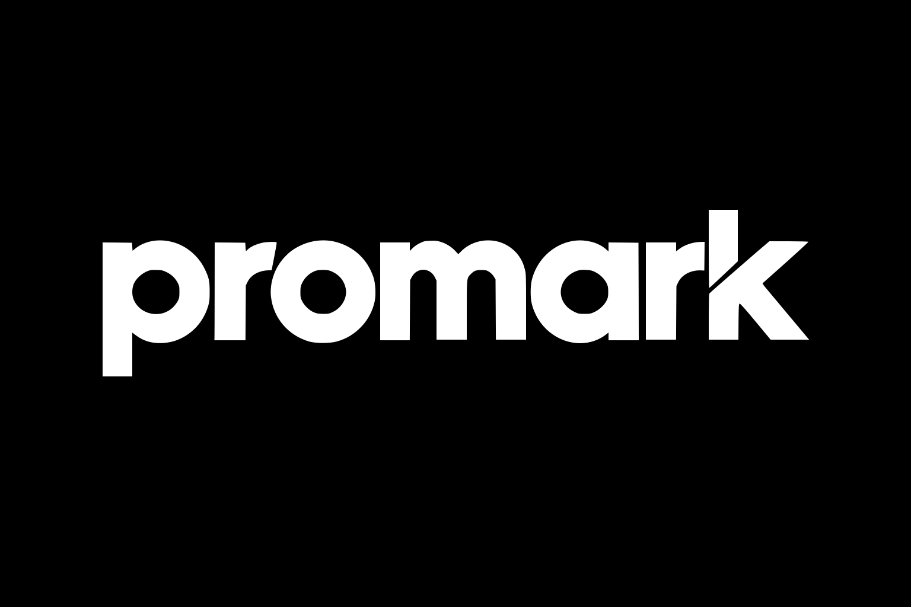

# Sticky components: markup patterns and build rules

Class names match `promark-style.css`. Rename them freely, but keep the structure.

## Fonts (pinned, SIL OFL)

| File | URL | SHA-256 |
|---|---|---|
| anton.woff2 | https://cdn.jsdelivr.net/npm/@fontsource/anton@5.2.5/files/anton-latin-400-normal.woff2 | f9ad420bf51c2930fc2a49d44209d202cb18acb2d8b82853a01023e69eab6885 |
| caveat.woff2 (variable 400–700) | https://cdn.jsdelivr.net/npm/@fontsource-variable/caveat@5.2.5/files/caveat-latin-wght-normal.woff2 | 26294b6b2c91b3970aca8fbbcb3e6c553ecb1ebb355b7ffbd30fa2f5370fe733 |
| geist.woff2 (variable) | https://cdn.jsdelivr.net/npm/@fontsource-variable/geist@5.3.0/files/geist-latin-wght-normal.woff2 | 19f9c92546aa300c312235e3125af1b81394d8db9a4bc4a425cd5b641d2d54e1 |
| geist-mono.woff2 (variable) | https://cdn.jsdelivr.net/npm/@fontsource-variable/geist-mono@5.3.0/files/geist-mono-latin-wght-normal.woff2 | 684ad5b531f81d43c1e8c7038262d5db7cdc1f68006e04d6c7769efa8d33c8cc |
| three.module.min.js | https://cdn.jsdelivr.net/npm/three@0.160.0/build/three.module.min.js | 3e690ac7d180b0aadf0891bea39eec643e29e2d3e75c99b18689518665f69ba6 |

Preload Anton. In a single-file artifact, load fonts from Google Fonts (Anton, Caveat; Geist is on Google Fonts too) and Three.js from `https://cdn.jsdelivr.net/npm/three@0.160.0/build/three.module.min.js`.

## Navigation (agency bar + burger)

```html
<header class="topline">
  <p class="topline-note mono">Agence marketing<br>& création · Ville</p>
  <a class="logo-frame" href="/" aria-label="Brand, accueil"></a>
</header>
<nav class="pill" aria-label="Navigation principale">
  <ul class="nav-links"><li><a href="/">Accueil</a></li><li><a href="/services/" aria-current="page">Services</a></li>…</ul>
  <a class="btn btn-ink nav-cta" href="/contact/">Parlons de votre projet <span aria-hidden="true">→</span></a>
  <div class="pill-menu">
    <button class="pill-toggle" type="button" aria-expanded="false" aria-controls="pill-links"><span class="burger" aria-hidden="true"></span><span class="sr-only">Ouvrir le menu</span></button>
    <ul id="pill-links" class="pill-links" hidden>…same links…</ul>
  </div>
</nav>
```
JS: toggle `hidden` and `aria-expanded`, close on link click, outside click and Escape (return focus to the toggle).

## Hero

```html
<section class="hero paper">
  <div class="hero-head"><h1 class="mono hero-kicker">Agence marketing digital à Ville</h1><p class="hand hero-we" aria-hidden="true">on rend les marques…</p></div>
  <p class="display hero-display"><span class="sr-only">Marques remarquées</span>
    <span class="hero-word" aria-hidden="true"><span>M</span><span>A</span>…</span>
    <span class="hero-word" aria-hidden="true"><span>R</span>…</span></p>
  <div class="hero-foot"><p class="hero-offer">One-sentence offer.</p><div class="cta-actions hero-actions">…buttons…</div></div>
  <canvas class="hero-3d" data-3d="hero" data-brand="BRAND" data-ring="AGENCE ✦ VILLE ✦ PAYS ✦ " data-tagline="marques remarquées" data-stamp="100% FAIT À VILLE" role="img" aria-label="Rouleau de ruban adhésif en 3D : faites-le glisser pour le tourner"></canvas>
  <div class="hero-fallback" aria-hidden="true"><span></span></div>
  <p class="hand hero-hint" aria-hidden="true">glissez-moi pour tourner ↻</p>
</section>
```
- The hero canvas is `position:absolute; height:calc(100% + 28vh)`, so the roll overlaps the next section. The hero has `z-index:2`.
- The canvas has `pointer-events:none`. Drag is handled on the hero element and ignores links and buttons.
- The hero's `::after` is the dark hill: `mask: radial-gradient(ellipse 72% 60% at 50% 0, transparent 99.4%, #000 100%)`.
- The SEO H1 can be the small kicker, while the giant words are a `<p>` with sr-only text.

## Pinboard (manifesto)

```html
<section class="section dark paper manifesto"><div class="wrap manifesto-grid">
  <div class="board">
    <div class="note-sticky"><span class="tape tape-top"></span><p class="note-title">À faire</p><ul class="hand"><li>…</li></ul></div>
    <figure class="snapshot"><span class="tape"></span></figure>
    <p class="hand scribble" aria-hidden="true">fait à Ville ✦ avec soin</p>
  </div>
  <div class="kraft"><span class="tape tape-wide"></span><div class="label-row mono"><span>Contenu</span>…</div><p class="lead-xl" data-wipe>Big brown Anton statement.</p></div>
</div></section>
```

## 3D object slot (cards, intros, CTA)

```html
<div class="obj obj-web" aria-hidden="true"><canvas data-3d="web"></canvas><div class="obj-fallback"><!-- SVG illustration or <span class="blob"></span> --></div></div>
```
Service card: `<article class="card card-web"><span class="tape tape-top"></span>[obj]<div class="card-text"><p class="mono card-num">03 / …</p><h3><a class="stretched" href="…">Title</a></h3><p>…</p></div></article>`. Card colours: yellow, cream, ink and lime on an orange section.

## Sticker (round, rotating text)

```html
<a class="sticker" href="/services/"><svg viewBox="0 0 120 120" aria-hidden="true"><defs><path id="ring-1" d="M60,60 m-45,0 a45,45 0 1,1 90,0 a45,45 0 1,1 -90,0"/></defs><text><textPath href="#ring-1">TOUS NOS SERVICES ✦ TOUS NOS SERVICES ✦ </textPath></text></svg><span class="sticker-core"><span class="sr-only">Tous nos services</span><span aria-hidden="true">→</span></span></a>
```
Give each sticker a unique path id.

## Tape marquee

```html
<div class="tape-band band-ink" aria-hidden="true"><div class="tape-track"><span>Marques remarquées</span><b>✦</b> …repeat ~10×…</div></div>
```

## Project row (taped print + kraft/cream caption)

```html
<article class="project"><a class="poster" href="/work/x/" tabindex="-1" aria-hidden="true"><span class="tape"></span><span class="play-dot"></span></a>
<div class="project-text"><p class="mono project-meta"><span>Client</span><span>Service</span></p><h3><a href="/work/x/">Title</a></h3><p>…</p><a class="text-link" href="/work/x/">Voir l’étude de cas →</a></div></article>
```
Even rows swap sides and tilt the other way.

## CTA

Orange section, `obj('star')` placed top-right, a giant Anton heading (max 13ch), a Caveat note "pour tout ce qui compte ↘", the paragraph and two buttons (ink and cream).

## Footer

An ink paper footer, then a lime tape marquee, then a giant wobbly brand word in lime Anton (about 19vw), then the logo sticker, then three link columns and a dotted rule.

## Buttons and links

`.btn` uses Anton uppercase 19px, a 3px ink border, 14px radius and a `4px 5px 0 ink` shadow. On hover it moves `translate(-2px,-3px) rotate(-1.5deg)`.

| Variant | Light background | Dark section |
|---|---|---|
| `btn-ink` | ink background, lime text | flips to lime background |
| `btn-ghost` | cream background | — |
| `btn-ghost-dark` | — | cream outline |

`.text-link` is Anton with a 4px underline bar: orange on light, lime on dark, ink on lime or orange. On hover the bar grows behind the text.

## Build rules learned the hard way

- **Line-height:** keep the display line-height ≥ 1 for accented capitals (É, À). The hero words can go to .88 because they have no accents on the first line.
- **CSP:** strict servers block inline `style` attributes. Use `nth-child` rules for per-letter wobble.
- **Overflow:** curves and rotated bands overflow. Use `overflow-x:clip` on `main` and the footer, and `overflow-x:hidden` on the body.
- **Hero layout:**
  - Keep the hero satellites in the side margins: shrink the hero word size to leave about 20% on each side.
  - On mobile, show only 3 satellites, scale the roll up and move it lower.
  - Limit the tape-tail length so it never reaches the canvas bottom.
- **Low contrast:** lime objects vanish on lime. Use ink variants (`starInk`) there.
- **Heart shape:** flip it with `rotateZ(Math.PI)`, not `scale(…, -1, …)`.
- **Object rotation:** builders may set their own rotation. The engine adds the default tilt (`+=`) instead of overwriting it.
